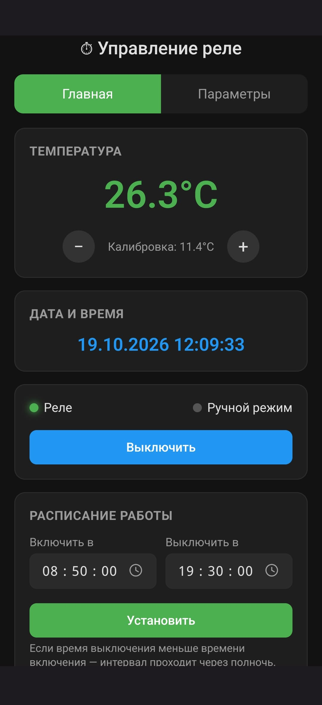
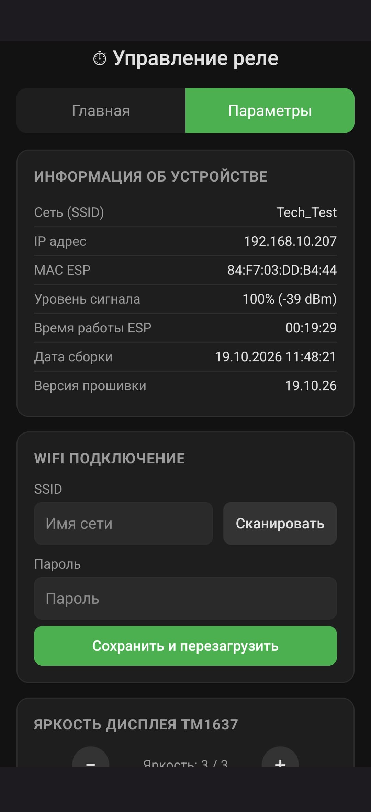

## RelayTimer — Реле времени по расписанию, с возможностью ручного Включения/Выключения розетки.

###  

### Платформа

Arduino IDE 1 и 2 версий (плата MightyCore)
 
_Проект полностью открыт и распространяется по лицензии GPL-3.0-or-later._

Ссылки на [GitFlic](https://gitflic.ru/project/otto/relaytimer) и [GitHub](https://github.com/Otto17/RelayTimer).

---

## ⚙️ Возможности

* Управление реле через веб-интерфейс
* Управление реле сенсорной кнопкой
* Настройка расписания работы реле
* Синхронизация времени через NTP
* Подключение к Wi-Fi в режимах STA и AP
* Отображение температуры и IP-адреса на дисплее TM1637
* Регулировка яркости дисплея
* Сохранение настроек устройства в NVS
* Обновление прошивки через веб-интерфейс (OTA)
* Перезагрузка устройства и сброс настроек

## 🔧 Аппаратная часть

* **ESP32-S2** — микроконтроллер
* **Реле** — одноканальный модуль 5 В
* **TM1637** — четырёхразрядный семисегментный дисплей
* **NTC термистор** — измерение температуры
* **Сенсорная кнопка (в виде круглой пластинки)** — управление реле

---

## 📋 Заметки

Проект делал для своих целей, дав к нему доступ по через свободную и открытую лицензию GPL-3.0-or-later.

Со схемой подключния не заморачивался, поэтому нарисовал её по быстрому, но суть подключения понятна.

Для согласования уровней сигналов между ESP32-S2 и реле с семисегментным индикатором на TM1637 использовал 4-канальный двунаправленный преобразователь логических уровней на полевых транзисторах.

---

**Скриншоты:**

****
****

Все скриншоты в [**Images**](screen)

---

**Автор Otto, г. Омск 2026**